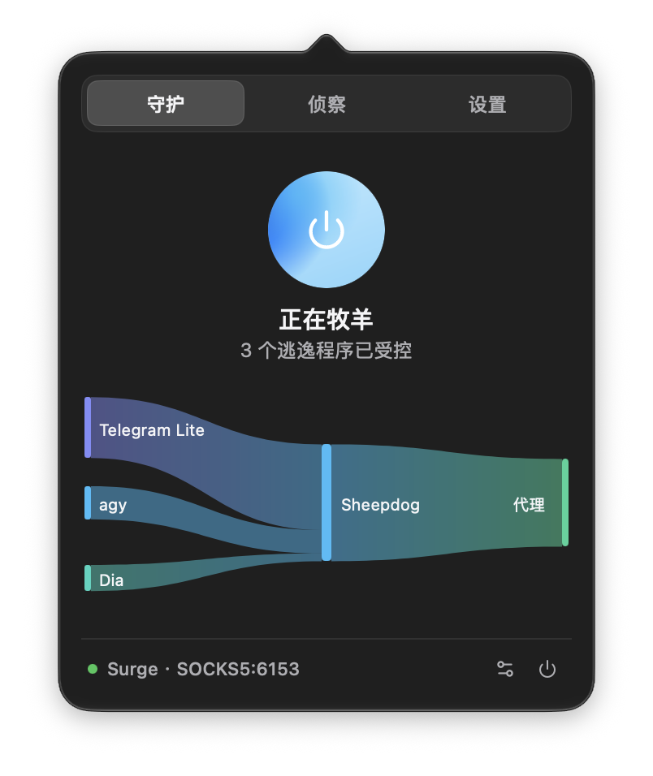

# Sheepdog (牧羊犬)

专为 macOS 打造的本地代理伴侣，把偷跑直连的终端流量精准赶回已有代理。

自动捕获 `git`、`brew`、`curl`、Cursor、Docker 等绕过系统代理的原始 TCP 流量，就地改写并重新喂给本机已有的代理工具（Surge、Clash 等）统一出站。

> [!IMPORTANT]
> **前置注意**：若已开启代理工具自带的 **TUN 模式** 或 **增强模式**（如 Surge 增强模式），请**不要**同时开启 Sheepdog（两者会在系统虚拟网卡和路由上产生冲突）。

<p align="center">
  
</p>

---

## 前言：“为了这碟醋，包了这顿饺子”

平时在 Mac 上挂着代理工具，大多数日常软件（如 Safari、Chrome）都会遵从系统代理设置。

但我一直想弄明白一件事：**在日常挂着系统代理（无 TUN 模式）的情况下，到底有多少流量在不打招呼地偷偷直连？具体是哪些软件和进程？**

做开发的都知道，终端命令行（`git`、`brew`、`curl`、`pip`）、现代代码编辑器与 AI 扩展（Cursor、VS Code 插件市场）、以及各种容器后台工具，默认根本不认系统代理，绕过代理直连外网，拉代码、下依赖时频频超时卡顿。

既然想把偷跑的进程揪出来，索性就“包了这顿饺子”：**抓到了偷跑的进程后，把它们通通赶回到已有的代理工具中进行分流出站。**

这也是名字 **Sheepdog (牧羊犬)** 的由来：  
网络流量就像羊群，大部分日常软件老老实实跟着大部队走系统代理；但总有些开发工具像“离群偷跑的小羊”。Sheepdog 自己不建羊圈（不提供代理节点），它只做一只本分的牧羊犬——**把那些离群乱跑的小羊，一只只安全赶回你原本的羊圈（代理工具）里。**

---

## 核心特性与优势

1. **通用的本地代理伴侣**  
   不绑定任何特定客户端。无论你用的是 Surge、Clash、Mihomo、v2rayA 还是自建代理，只要本地开放了 SOCKS5/HTTP 端口，挂上 Sheepdog 就能立刻补齐对逃逸流量的捕获能力（*前提是不开启原客户端的 TUN 或增强模式*）。
2. **偷跑流量的实时监控与管理**  
   不仅把流量赶回去，还自带一个直观的监控面板：
   - **守护河流**：实时桑基图直观呈现哪些应用在偷跑、分别流向了代理还是直连；
   - **侦察清单**：一键查看当前正在外联的进程，随时针对特定应用进行直连避让或接管。
3. **极度轻量，不伤内网**  
   - **不篡改系统 DNS**：不修改 macOS 系统 DNS 设置，不运行 Fake-IP 虚拟 DNS 服务，避免了传统客户端崩溃导致全机断网的隐患；
   - **内网物理直通**：AirDrop 隔空投送、局域网 NAS、本地打印机及本地容器间通信在内核路由层直连物理网卡，互不干扰；
   - **退出毫秒级复原**：关闭即销毁虚拟网卡与路由表；由于 `utun` 具备内核生命周期绑定，若遇进程异常退出，系统内核亦会瞬间自动销毁网卡复原路由，无系统配置残留。

---

## 处理边界与技术细节说明

```text
┌────────────────────────────────────────────────────────────────────────┐
│                              Mac 上的应用                              │
├────────────────────┬─────────────────────────────┬─────────────────────┤
│   1. 局域网通信    │        2. 常规应用          │    3. 偷跑程序      │
│  (AirDrop / NAS)   │       (Safari/Chrome)       │  (git/brew/Cursor)  │
└─────────┬──────────┴──────────────┬──────────────┴──────────┬──────────┘
          │ (内网直连)              │ (遵从系统代理设置)      │ (忽略系统代理, 试图直连)
          │                         │                         ▼
          │                         │               ┌──────────────────┐
          │                         │               │  Sheepdog 捕获   │
          │                         │               │ ├─ 原地转为SOCKS5│
          │                         │               │ └─ 嗅探真实域名  │
          │                         │               └─────────┬────────┘
          │                         ▼                         │
          │                  ┌────────────────────────────────▼────────┐
          │                  │      本机已有的代理工具 (Surge / Clash) │
          │                  │             (监听本地端口)              │
          │                  └────────────────────┬────────────────────┘
          ▼                                       ▼ (强制绑定物理网卡出站)
    物理网卡 (en0) ────────────────────────► 互联网出站
```

1. **QUIC / HTTP/3 快速降级**：  
   检测到公网 UDP 443（QUIC）请求时，主动回送标准的 ICMP 端口不可达（Port Unreachable）报文，促使支持 QUIC 的应用或 curl 在毫秒级内无感降级为 HTTP/2 (TCP) 走透明代理，避免静默丢包带来的等待卡顿。
2. **SSH 与纯 IP 流量接管**：  
   未携带 TLS SNI 域名的连接（例如 `git@github.com` 的 SSH 22 端口，或直接基于目标 IP 发起的请求），自动回退至标准 SOCKS5 IPv4/IPv6 目标地址路由模式，同样交给本地代理出站。*(注：若需按域名走代理，可配置 `ssh.github.com:443`)*。
3. **UDP 流量支持**：  
   启动时自动探查上游代理是否具备 UDP 转发能力。上游支持时接管非 443 通用 UDP 流量；上游不支持时自动安全走物理网卡直连。
4. **DNS 运作机制**：  
   不碰系统 DNS 配置。应用发起连接前的域名解析仍由系统原有 DNS 负责；Sheepdog 通过反向 NAT 原地改写数据包并增量重算 TCP/IP 校验和，同时嗅探首包的 TLS SNI / HTTP Host 提取真实目标域名送入已有代理。
5. **防回环机制**：  
   通过进程 PID 与二进制路径动态关联，精准识别 Surge、Clash 等代理工具自身向远端代理节点发起的连接，将其直接放行走物理网卡，不修改系统静态路由表，阻断死循环。
6. **产品边界**：  
   Sheepdog 自身不是代理客户端，不提供梯子节点与协议解密，必须搭配本机已运行的代理工具（Surge、Clash 等）使用。

---

## 为什么不直接用代理自带的 TUN？与 Proxifier 有何不同？

### 为什么不直接用自带 TUN？
1. **当然可以**：如果你日常开着代理工具自带的 TUN / 增强模式，用得顺手且毫无问题，完全可以继续使用，**不需要使用本工具**；
2. **打不开或没有 TUN 时**：有些代理客户端比较轻量，本身没有 TUN 功能；或者遇到系统权限、内核扩展冲突打不开增强模式时，可以用 Sheepdog 作为即开即用的独立透明分流伴侣；
3. **想要上述好处时**：嫌全局 TUN 太重、不想被全局劫持 DNS、或者需要 AirDrop 和局域网设备稳定互联时，可以用 Sheepdog 搭配普通代理端口使用。

### 与 Proxifier 等工具的区别
- **零规则配置**：无需手动编写繁琐的进程过滤与目标端口规则，开箱即用，自动嗅探代理端口；
- **原生可视化**：内置实时流量拓扑桑基图与外联进程清单监控；
- **轻量开箱即用，且完全免费**。

---

## 安全与隐私

- **纯本地离线运行**：零遥测、零数据回传、无后台统计分析；
- **内存瞬时驻留**：流量拓扑与外联进程清单仅保存在本机瞬时内存，不持久化到磁盘，退出即焚；
- **最小特权原则**：特权辅助工具（Helper）仅负责按需创建 `utun` 网卡与维护临时路由，不篡改任何第三方进程；
- **完整性校验**：每次 Release 均提供安装包的 `SHA256SUMS` 校验清单供核验。

---

## 系统要求与安装

### 系统要求
- **macOS**：macOS 15.0 (Sequoia) 及以上
- **架构**：原生 Universal 通用二进制（支持 Apple Silicon M 系列与 Intel 64 位架构）

### 安装与运行
从 [Releases](https://github.com/666OS/Sheepdog/releases) 下载最新的 `.dmg` 镜像，把 `Sheepdog.app` 拖入 `Applications`（应用程序）。

1. **开箱即用**：启动后常驻菜单栏，自动探测本机正在运行的代理端口（亦可手动选择或填写）；
2. **一键守护**：点击中央大图标开启（首次开启需要授权一次特权辅助工具以创建网卡，后续开关无感免密）；
3. **即走无残留**：右键菜单栏图标退出，虚拟网卡与路由瞬间自动注销复原。

---

## 彻底卸载

Sheepdog 遵循 macOS 标准特权辅助工具架构。如果不再使用，只需将 `Sheepdog.app` 移入废纸篓，并在终端执行以下命令彻底卸载并清除特权辅助工具与启动守护项：

```bash
sudo launchctl bootout system/com.sheepdog.helper 2>/dev/null || true
sudo rm -f /Library/PrivilegedHelperTools/com.sheepdog.helper
sudo rm -f /Library/LaunchDaemons/com.sheepdog.helper.plist
sudo rm -f /var/run/com.sheepdog.helper.sock
```

---

## 软件许可与分发说明

- **分发形态**：Sheepdog 现阶段作为**免费编译二进制（Freeware Binary）**公开发布，个人与商业均可免费使用。
- **版权声明**：软件版权由 666OS 保留。详细条款参见 [LICENSE](LICENSE)。
