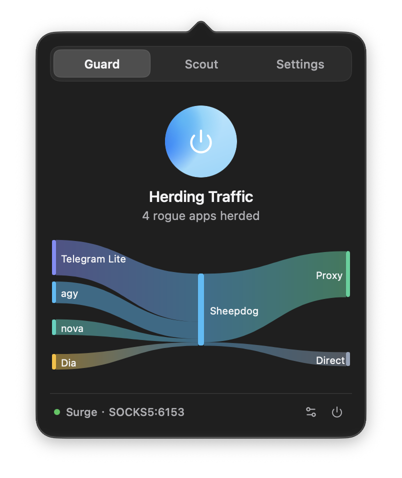

<p align="center">
  
</p>

# Sheepdog

<p align="center">
  <a href="README.md">简体中文</a> | <b>English</b>
</p>

A lightweight local proxy companion crafted for macOS — faithfully herding rogue direct developer & terminal traffic back into your existing local proxy.

Automatically captures raw TCP traffic from `git`, `brew`, `curl`, Cursor, Docker, and other developer tools that ignore system proxies, transparently rewrites it, and feeds it into your existing local proxy client (Surge, Clash, etc.) for unified outbound routing.

> [!IMPORTANT]
> **Pre-requisite Notice**: If your proxy client already has **TUN Mode** or **Enhanced Mode** enabled (such as Surge Enhanced Mode), please **do not** run Sheepdog simultaneously (both manage virtual network interfaces and kernel routes, causing conflicts).

<p align="center">
  
</p>

---

## The Story: "For a Drop of Vinegar, I Made a Table of Dumplings"

When running a proxy client on macOS, most regular applications (like Safari and Chrome) respect system proxy settings without issue.

However, a nagging question remained: **When running in standard system proxy mode (without TUN), exactly how much traffic is secretly bypassing the proxy and connecting directly? Which specific applications and processes are doing this?**

Every developer knows that command-line tools (`git`, `brew`, `curl`, `pip`), modern AI code editors (Cursor, VS Code extensions), and container runtimes (Docker) ignore system proxies by default. They attempt direct outbound connections, frequently leading to timeouts and sluggish dependency downloads.

Rather than just detecting rogue connections, it made sense to "make a full table of dumplings": **once stray processes are identified, transparently redirect them back into your existing proxy client for unified outbound routing.**

This is where the name **Sheepdog** comes from:  
Network traffic behaves like a flock of sheep — standard applications follow the flock along system proxy rules, but developer tools act like stray lambs breaking away. Sheepdog doesn't build its own sheepfold (it does not provide proxy nodes); it simply acts as a faithful sheepdog — **safely rounding up stray lambs and herding them back into your existing sheepfold (your proxy client).**

---

## Key Features & Highlights

1. **Universal Local Proxy Companion**  
   Completely client-agnostic. Whether you use Surge, Clash, Mihomo, v2rayA, or a custom local proxy, as long as a local SOCKS5 or HTTP port is listening, Sheepdog seamlessly captures escaping traffic (*provided the client's own TUN/Enhanced mode is turned off*).
2. **Real-Time Traffic Observability & Management**  
   More than just a router — Sheepdog includes an intuitive visual dashboard:
   - **River of Guardians**: Real-time Sankey diagram visualizing which applications are connecting and whether they flow to proxy or direct.
   - **Recon List**: Instant inspection of all active outbound processes, with one-click toggles for direct bypass or guarded proxying.
3. **Ultra-Lightweight & Clean LAN Integration**  
   - **Zero DNS Tampering**: Does not alter macOS system DNS resolvers or run virtual Fake-IP DNS servers, eliminating widespread connection drops when a client crashes;
   - **Direct LAN Routing**: AirDrop, local NAS, network printers, and inter-container traffic bypass the virtual interface at the kernel routing layer, operating with zero interference;
   - **Millisecond Clean Restoration**: Quitting immediately destroys the virtual interface and restores routing tables. The main GUI maintains a live Unix Domain Socket session with the helper; if the main app terminates or crashes, the helper automatically tears down the `utun` interface and routing entries.

---

## Technical Architecture & Processing Boundaries

```text
┌────────────────────────────────────────────────────────────────────────┐
│                          Applications on macOS                         │
├────────────────────┬─────────────────────────────┬─────────────────────┤
│ 1. Local Network   │    2. Standard Apps         │   3. Rogue Processes│
│  (AirDrop / NAS)   │     (Safari / Chrome)       │  (git / brew / IDE) │
└─────────┬──────────┴──────────────┬──────────────┴──────────┬──────────┘
          │ (Direct LAN)            │ (Follows System Proxy)  │ (Bypasses Proxy, Direct)
          │                         │                         ▼
          │                         │               ┌────────────────────┐
          │                         │               │  Sheepdog Capture  │
          │                         │               │ ├─ SOCKS5/HTTP Nat │
          │                         │               │ └─ Sniff SNI / Host│
          │                         │               └─────────┬──────────┘
          │                         ▼                         │
          │                  ┌────────────────────────────────▼────────┐
          │                  │      Local Proxy Client (Surge / Clash) │
          │                  │             (Listening on local port)   │
          │                  └────────────────────┬────────────────────┘
          ▼                                       ▼ (Direct relay bound to en0)
    Physical NIC (en0) ─────────────────────► Internet Outbound
```

1. **QUIC / HTTP/3 Fast Downgrade**:  
   When outbound UDP 443 (QUIC) packets are detected, Sheepdog actively responds with standard ICMP Port Unreachable packets. This signals QUIC-capable applications to gracefully and instantly fallback to HTTP/2 (TCP) within milliseconds, avoiding silent packet drop timeouts.
2. **SSH & Raw IP Traffic Handling**:  
   For traffic without TLS SNI (such as `git@github.com` over SSH port 22 or direct IP connections), Sheepdog automatically falls back to standard SOCKS5 IPv4/IPv6 destination address routing. *(Tip: To route SSH by domain rules in your proxy, configure ProxyCommand in `~/.ssh/config`, e.g., `Host github.com` \ `ProxyCommand nc -X 5 -x 127.0.0.1:7890 %h %p`)*.
3. **UDP Support Policy**:  
   On startup, Sheepdog probes the upstream proxy's UDP capability. If supported, generic non-443 UDP traffic is proxied (excluding port 53 DNS queries, which remain handled directly by system resolvers); if unsupported, UDP safely routes directly via physical interfaces.
4. **DNS Architecture**:  
   Does not modify system DNS settings. Pre-connection DNS lookups are resolved normally by your existing system DNS servers. Sheepdog rewrites intercepted TCP packets via reverse NAT with incremental checksum recalculation (RFC 1624), while sniffing TLS SNI / HTTP Host headers from the initial packet to provide the destination domain to the proxy.
5. **Anti-Loop Protection**:  
   Dynamically identifies proxy client processes via PID and executable binary path association. Connections initiated by the proxy client to remote nodes are directly relayed to the physical network interface without polluting system static routing tables, eliminating routing loops.
6. **Product Boundaries**:  
   Sheepdog is not a proxy service provider. It does not supply remote proxy nodes or protocol decryption, and must be paired with an existing proxy client running locally (Surge, Clash, etc.).

---

## Why Not Built-in TUN? How Does It Differ from Proxifier?

### Why Not Built-in TUN?
1. **You certainly can**: If your proxy client's built-in TUN / Enhanced Mode already works smoothly for you, you can continue using it — **Sheepdog is not needed**;
2. **When TUN is unavailable or problematic**: Lightweight proxy clients often lack TUN support; or when system permissions and kernel conflicts prevent enhanced mode from launching, Sheepdog serves as a plug-and-play standalone companion;
3. **When you prefer clean separation**: If you want to avoid heavy global TUN, bypass Fake-IP DNS hijacking, or ensure pristine local network and AirDrop connectivity, Sheepdog pairs cleanly with standard proxy ports.

### Differences from Proxifier
- **Zero Configuration Rules**: No need to write complex per-application and port filter rules; automatically detects active local proxy ports out of the box;
- **Native Visual Observability**: Built-in real-time Sankey diagram topology and active process inspection;
- **Lightweight, Plug-and-Play, and Free**.

---

## Security & Privacy

- **100% Offline & Local**: Zero telemetry, zero analytics, and zero data transmission (except when explicitly checking for updates via GitHub Releases);
- **Ephemeral In-Memory State**: Traffic topology and process lists exist exclusively in volatile RAM — never written to disk, and cleared upon exit;
- **Least-Privilege Daemon**: The privileged helper strictly manages `utun` device creation and temporary routing; it never inspects or injects into third-party process memory;
- **Integrity Verification**: Every official release provides a signed `SHA256SUMS` manifest for independent checksum verification.

---

## System Requirements & Installation

### System Requirements
- **macOS**: macOS 15.0 (Sequoia) or later
- **Architecture**: Native Universal Binary (Apple Silicon M-series & Intel 64-bit)

### Installation & Quick Start
Download the latest `.dmg` installer from [Releases](https://github.com/666OS/Sheepdog/releases) and drag `Sheepdog.app` into `Applications`.

1. **Plug and Play**: Runs in the menu bar and automatically detects listening proxy ports (or enter a custom port manually);
2. **One-Click Guard**: Click the central icon to start (prompts once for privileged helper authorization to establish the virtual interface; subsequent toggles are seamless);
3. **Zero Leftovers**: Right-click the menu bar icon to quit; virtual interfaces and routing entries are instantly unmounted and restored.

---

## Clean Uninstallation

Sheepdog follows standard macOS Privileged Helper Tool architecture. If you wish to remove it, drag `Sheepdog.app` to the Trash, and run the following commands in Terminal to completely unload and remove the daemon and socket:

```bash
sudo launchctl bootout system/com.sheepdog.helper 2>/dev/null || true
sudo rm -f /Library/PrivilegedHelperTools/com.sheepdog.helper
sudo rm -f /Library/LaunchDaemons/com.sheepdog.helper.plist
sudo rm -f /var/run/com.sheepdog.helper.sock
```

---

## Software License & Distribution

- **Distribution**: Sheepdog is currently distributed as **Freeware Binary**, free for both personal and commercial use.
- **Copyright**: Copyright (c) 2026 666OS. All rights reserved. See [LICENSE](LICENSE) for details.

